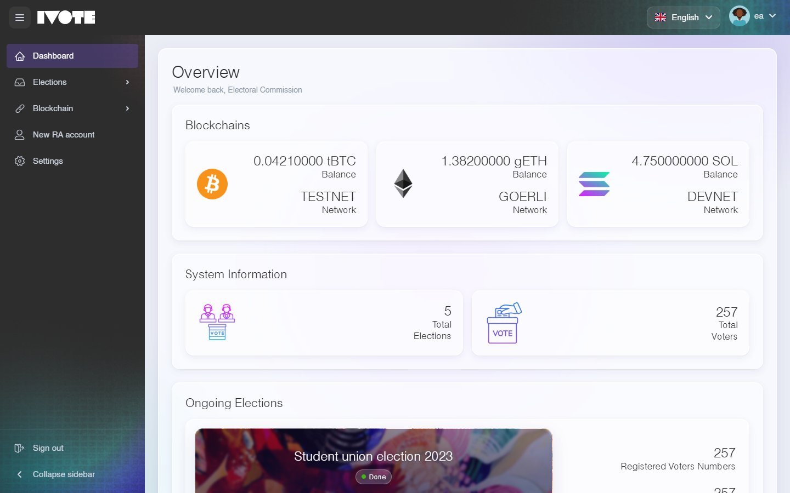
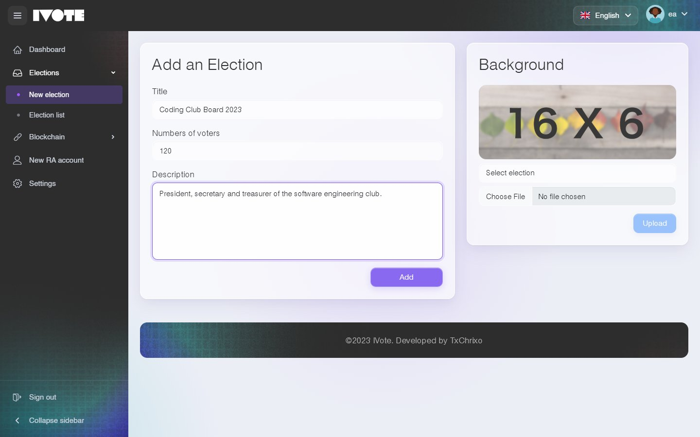
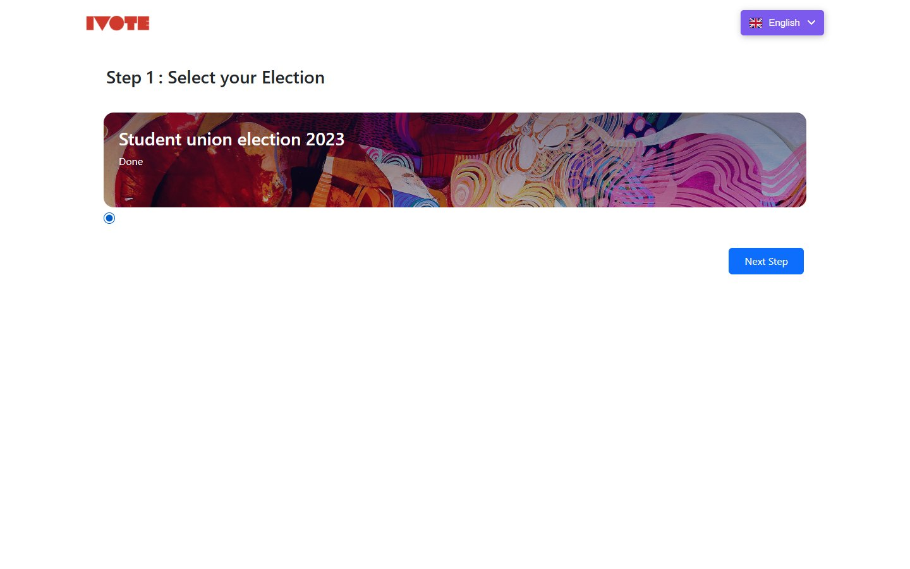

<p align="center">
  
</p>

<h3 align="center">Design and Implementation of an Electronic Voting System<br>Based on Blockchain and Cryptographic Techniques</h3>

<p align="center">
  Bachelor's thesis · IUT de Douala, University of Douala · 2023
</p>

<p align="center">
  
  
  
  
  
</p>

---

| | |
|---|---|
| **Author** | NANA TCHOUNKEU Thierry Christian |
| **Academic supervisor** | Dr. JDD NKAPKOP |
| **Professional supervisor** | Mr. DJIMELI Christian (CODEC) |
| **Degree** | Licence de Technologie, Software Engineering |
| **Institution** | Institut Universitaire de Technologie (IUT), University of Douala |
| **Host company** | CODEC group, Douala |
| **Year** | 2023 |

## Abstract

Electronic voting speeds up tabulation and widens access, but only earns trust if ballots stay
secret and anyone can check the result. IVote combines the **Bitcoin blockchain** with
**ring signatures**: each vote is a testnet transaction whose `OP_RETURN` carries a ring
signature over the chosen candidate. The signature proves the voter belongs to the registered
electorate without revealing who they are, and the public ledger lets every voter confirm their
ballot was counted unchanged, while organisers can neither alter results nor see voters'
identities.

The system was modelled with UML following the 2TUP process and built with PHP, Laravel
and MySQL.

## Election walkthrough

An election moves through five stages: **Initial → Identity check → Waiting → Voting → Closed**.
Three actors take part: the **Election Authority** (EA), the **Registration Authority** (RA) and the **voter**.

| # | Stage | Actor | What happens |
|:-:|---|---|---|
| 1 | Setup | EA | Signs in with a password and TOTP, configures the Bitcoin wallet, creates the election. |
| 2 | Setup | RA | Registers the candidates of each election. |
| 3 | Identity check | Voter | Proves their identity through Veriff and receives a personal link by email. |
| 4 | Identity check | Voter | Generates a key pair in the browser; only the public key is registered. |
| 5 | Waiting | EA | Funds one fresh testnet address per voter, tagged with `OP_RETURN hash(PK)`. |
| 6 | Voting | Voter | Signs the ballot with a ring signature and sends it to the EA address in `OP_RETURN`. |
| 7 | Closed | Anyone | Decodes the transactions, checks every signature and counts the first vote per address. |
| 8 | Closed | Voter | Finds their own transaction to confirm the ballot was counted (individual verifiability). |

### Screens

<table>
  <tr>
    <td width="33%"></td>
    <td width="33%"></td>
    <td width="33%"></td>
  </tr>
  <tr>
    <td align="center"><b>1.</b> Back-office sign-in</td>
    <td align="center"><b>1.</b> TOTP second factor</td>
    <td align="center"><b>1.</b> EA dashboard</td>
  </tr>
  <tr>
    <td></td>
    <td></td>
    <td></td>
  </tr>
  <tr>
    <td align="center"><b>1.</b> EA testnet wallet</td>
    <td align="center"><b>1.</b> New election</td>
    <td align="center"><b>1.</b> Elections and their stage</td>
  </tr>
  <tr>
    <td></td>
    <td></td>
    <td></td>
  </tr>
  <tr>
    <td align="center"><b>2.</b> RA dashboard</td>
    <td align="center"><b>2.</b> New candidate</td>
    <td align="center"><b>2.</b> Candidates per election</td>
  </tr>
  <tr>
    <td></td>
    <td></td>
    <td></td>
  </tr>
  <tr>
    <td align="center"><b>3.</b> Identity check with Veriff</td>
    <td align="center"><b>3.</b> Check submitted</td>
    <td align="center"><b>3.</b> Personal ballot codes</td>
  </tr>
  <tr>
    <td></td>
    <td></td>
    <td></td>
  </tr>
  <tr>
    <td align="center"><b>4.</b> Voter link opened</td>
    <td align="center"><b>4.</b> Key pair generation</td>
    <td align="center"><b>4.</b> Waiting for the voting day</td>
  </tr>
  <tr>
    <td></td>
    <td></td>
    <td></td>
  </tr>
  <tr>
    <td align="center"><b>5.</b> Funding voter addresses</td>
    <td align="center"><b>5.</b> Address balances</td>
    <td align="center"><b>7.</b> Closed elections</td>
  </tr>
</table>

Screens show the demo data set (`DemoSeeder`); the wallet balance is mocked since the demo has no funded wallet.

## Architecture

```
 Voter browser ──(ring signature, key pair)──┐
                                             ▼
 Laravel app ── MySQL (elections, candidates, public keys, audit log)
     │
     ├── Veriff ............ identity verification
     ├── Block.io .......... funding voter addresses (OP_RETURN on Bitcoin testnet)
     └── CryptoAPIs ........ EA wallet balance
```

| Layer | Choice |
|---|---|
| Back end | PHP 8.1, Laravel 10, MySQL 8 |
| Front end | Blade, Bootstrap 5, jQuery, Vite |
| Blockchain | Bitcoin testnet (`OP_RETURN`), Block.io, CryptoAPIs |
| Cryptography | Ring signatures, secp256k1 keys, AES-256 encrypted keys at rest |
| Security | TOTP 2FA, role gates, CSP with nonces, rate limits, audit log |
| Method | 2TUP, UML |

## Getting started

Requirements: PHP 8.1+ with `gmp`, Composer, Node 18+, MySQL 8.

```bash
git clone https://github.com/Txchrixo/iVote.git && cd iVote
composer install && npm install
cp .env.example .env && php artisan key:generate
php artisan migrate --seed    # creates the EA and RA accounts, prints their passwords
npm run build && php artisan serve
```

Set `BLOCKIO_*`, `CRYPTOAPIS_API_KEY` and `VERIFF_*` in `.env` to reach the external services.

**Demo data.** To explore a full election season (five elections, candidates, ballot codes and
testnet addresses) on an empty database:

```bash
php artisan migrate:fresh --seed --seeder=DemoSeeder
```

Accounts `ea` and `ra` share a password and TOTP secret, both printed once
(or set through `DEMO_PASSWORD` and `DEMO_2FA_SECRET`). The seeder refuses to run in production.

## Tests

```bash
php artisan test
```

Feature tests cover authorization, two-factor sign-in, election stages, candidates, security
headers, the audit log and the public results pages.

## Repository layout

```
app/          controllers, models, election stages, security middleware
database/     migrations and seeders (including DemoSeeder)
resources/    Blade views, styles and page scripts
routes/       web routes (back office, voter flow, results)
tests/        feature and unit tests
docs/         screenshots
```

## Limitations and future work

- One voter could still receive several funded addresses; the address pool needs a binding
  to the registered public key.
- Ballot casting, the live tally and signature verification screens are still being wired
  to the ring signature library.
- The voter needs some technical comfort (keys, wallets); accessibility is limited.
- Transaction timing and amounts may allow linkability; mixing or batching would reduce it.
- Bitcoin fees and confirmation times do not scale to national elections.

## Citation

```bibtex
@thesis{nana2023ivote,
  author      = {Nana Tchounkeu, Thierry Christian},
  title       = {Design and Implementation of an Electronic Voting System Based on Blockchain and Cryptographic Techniques},
  type        = {Bachelor's thesis},
  institution = {Institut Universitaire de Technologie, University of Douala},
  year        = {2023}
}
```

## Acknowledgments

Dr. JDD NKAPKOP for the academic supervision, Mr. DJIMELI Christian and the CODEC team for
the internship and their blockchain expertise.

## License

MIT
